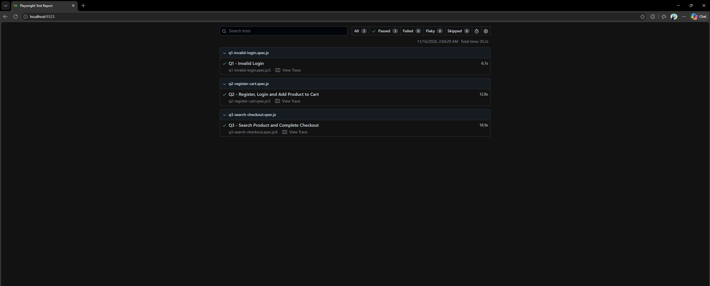
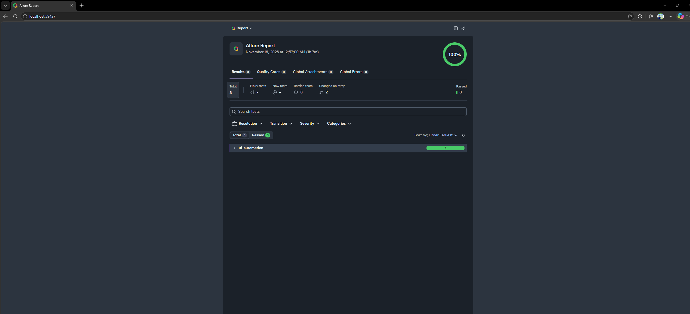

# Demo Web Shop Automation Project

<p align="center">

  **UI Automation | API Automation | Test Reporting**

  Automated testing project for Demo Web Shop using Playwright, Postman, and Newman.

</p>

---

## Project Overview

This project focuses on UI automation and API testing of the Demo Web Shop application.

The UI automation is implemented using Playwright with JavaScript and the Page Object Model (POM) design pattern. API automation is performed using Postman and Newman.

The project covers user registration, login validation, product search, shopping cart operations, checkout workflow, API request validation, automated test execution, and reporting.

## Project Objectives

- Automate UI test scenarios using Playwright.
- Implement Page Object Model (POM).
- Validate login and registration functionality.
- Automate shopping cart and checkout workflows.
- Perform API testing using Postman.
- Execute API collections using Newman.
- Generate Playwright HTML and Allure reports.
- Maintain test automation code using Git and GitHub.

## Application Under Test

- **Application:** Demo Web Shop
- **URL:** https://demowebshop.tricentis.com/
- **Testing Type:** UI Automation and API Testing

## Technologies Used

| Technology | Purpose |
|---|---|
| JavaScript | Programming Language |
| Node.js | Runtime Environment |
| Playwright | UI Automation |
| Postman | API Testing |
| Newman | API Test Execution |
| Allure Report | Test Reporting |
| Git | Version Control |
| GitHub | Source Code Repository |

---

## Project Structure

```text
Demo-Web-Shop-Automation/
│
├── API Automation/
│   └── newman/
│       ├── API Automation Collection
│       └── Newman Execution Report
│
├── Screenshort/
│   ├── allure-report.png
│   └── playwright-report.png
│
├── pages/
│   ├── CheckoutPage.js
│   ├── LoginPage.js
│   ├── ProductPage.js
│   └── RegisterPage.js
│
├── tests/
│   ├── q1-invalid-login.spec.js
│   ├── q2-register-cart.spec.js
│   └── q3-search-checkout.spec.js
│
├── README.md
├── package.json
├── package-lock.json
└── playwright.config.js
```

---

# UI Automation

## Page Object Model (POM)

The project follows the Page Object Model design pattern to separate page locators and actions from test cases.

### Page Classes

| Page Class | Responsibility |
|---|---|
| LoginPage.js | Login functionality |
| RegisterPage.js | User registration |
| ProductPage.js | Product search and cart operations |
| CheckoutPage.js | Checkout and order completion |

## Test Scenarios

### Q1 – Invalid Login

- Navigate to the login page.
- Enter invalid login credentials.
- Submit the login form.
- Verify the appropriate error message.

### Q2 – Register, Login and Add Product to Cart

- Navigate to the registration page.
- Register a new user.
- Verify registration success message.
- Logout from the application.
- Login with registered credentials.
- Navigate to the Books category.
- Open the Computing and Internet product.
- Add the product to the shopping cart.
- Verify product name and quantity in the cart.

### Q3 – Search Product and Complete Checkout

- Login to the application.
- Search for Computing and Internet.
- Verify search results.
- Open the product details page.
- Add the product to the shopping cart.
- Update product quantity to 2.
- Verify the updated quantity.
- Accept Terms of Service.
- Proceed to checkout.
- Complete billing and shipping steps.
- Select shipping and payment methods.
- Confirm the order.
- Verify order confirmation.
- Open and verify order details.

---

## Playwright Test Execution

### Prerequisites

- Node.js
- npm
- Git
- Playwright
- Chromium

### Install Dependencies

```bash
npm install
```

### Install Playwright Browser

```bash
npx playwright install chromium
```

### Run All UI Tests

```bash
npx playwright test
```

### Run Individual Test Cases

```bash
npx playwright test tests/q1-invalid-login.spec.js
```

```bash
npx playwright test tests/q2-register-cart.spec.js
```

```bash
npx playwright test tests/q3-search-checkout.spec.js
```

### Generate Playwright HTML Report

```bash
npx playwright show-report
```

### Generate Allure Report

```bash
npx allure generate allure-results --clean -o allure-report
```

### Open Allure Report

```bash
npx allure open allure-report
```

---

# API Automation

API testing is performed using Postman and Newman.

## API Testing Activities

- API request execution.
- HTTP response validation.
- Response body verification.
- Dynamic variables.
- API collection execution.
- Automated API testing using Newman.
- API execution report generation.

## API Automation Files

The `API Automation/newman/` directory contains the API automation collection and Newman execution report.

---

# Test Results

## Playwright Test Summary

| Test Case | Description | Status |
|---|---|---|
| Q1 | Invalid Login | PASS |
| Q2 | Register, Login and Add Product to Cart | PASS |
| Q3 | Search Product and Complete Checkout | PASS |

### Overall Result

| Metric | Result |
|---|---|
| Total UI Tests | 3 |
| Passed | 3 |
| Failed | 0 |
| Success Rate | 100% |

---

# Test Reports

## Playwright HTML Report



## Allure Report



---

# Git and GitHub

Git and GitHub are used for source code management and version control.

Project activities include:

- Repository management.
- Source code commits.
- Branch management.
- Version control.
- Code updates and synchronization.

## Repository

**GitHub Repository:**  
[Demo-Web-Shop-Automation](https://github.com/Rezuanh1/Demo-Web-Shop-Automation)

---

# Conclusion

This project demonstrates the implementation of UI automation and API testing using modern testing tools.

Playwright automates the major Demo Web Shop workflows, while Postman and Newman support API testing and automated execution.

The project also demonstrates the use of Page Object Model, automated test reporting, and GitHub-based version control.

---

## Author

**Rezuan Hussain**

GitHub: [Rezuanh1](https://github.com/Rezuanh1)

